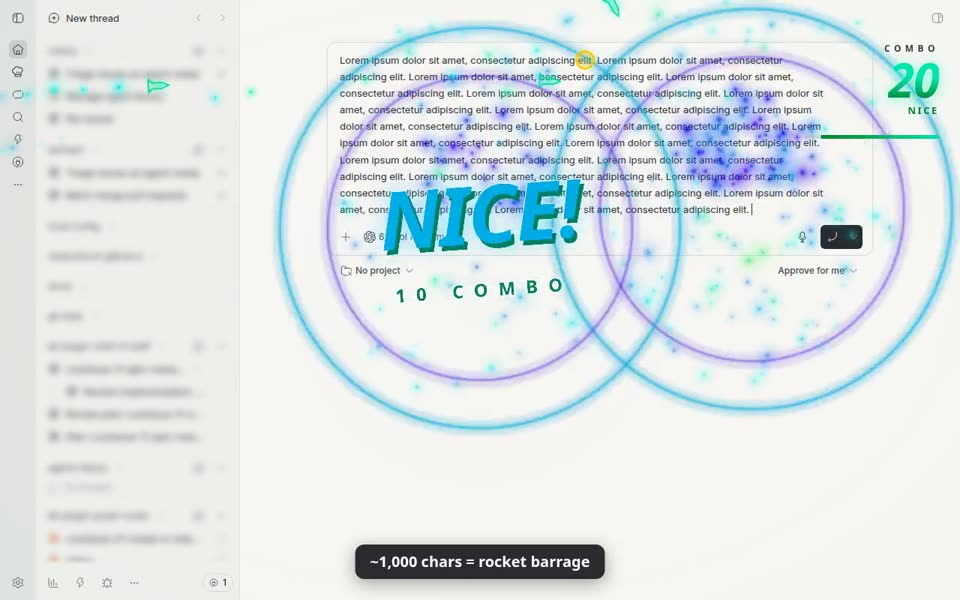

# Power Mode

Typing effects for bb, in the spirit of VS Code's Power Mode — turned up.

## Demo video

▶️ **[Watch the 84-second demo](https://cdn.jsdelivr.net/gh/cleanunicorn/bb-plugin-power-mode@81cac1e19cfeefbdefe92c90ce5973d0f70b509c/docs/media/power-mode-demo.mp4)** (MP4, 1280×800, no sound; [file in the repo](docs/media/power-mode-demo.mp4)): turning Power Mode on, typing combos, paste ordnance, switching the theme in Settings, and an agent reply through its "TURN COMPLETE" finale. [How it was recorded](docs/demo-video.md).

- Particle bursts from the caret, with a soft bloom glow (quarter-resolution, cheap). Fast sparks leave streaks, debris bounces off the bottom of the window, and explosions leave drifting smoke
- **Themes:** 🌈 Neon, 🔥 Inferno, 🟩 Matrix (falling code), 🌸 Sakura (drifting petals), 🌃 Cyberpunk, 👾 Retro 8-bit
- **Particles** and **Glow** sliders; particle counts also drop automatically when frames get slow
- **Reduce motion** (Settings): follows the OS `prefers-reduced-motion` setting until you choose; your explicit choice then sticks across OS changes and reloads. When active there is no editor/screen shake, no full-screen flash (including the white-out on tier 7–9 pastes and combo slams) and no lightning. Particles, slam text, the vignette pulse and bloom are unchanged.
- Editor shake on every keystroke; screen shake on Enter, paste, and combo milestones
- Combo counter with WPM gauge, draining timer, tier titles, and milestone slams with explosions and lightning. Slam titles land letter by letter, the HUD pulses once the combo passes 100, the timer bar flashes red with a "FADING" warning in its last 30%, and a streak of 25+ that ends without a record shatters off the HUD with a "COMBO LOST" slam
- Flying letters, red shards on Backspace, shockwave on Enter
- **Paste ordnance:** pasting drops theme-styled ordnance that scales with the paste, across 9 levels from firecracker to singularity (see below)
- **Agent Power Mode:** while an agent writes its reply, sparks fly from the newest text, an agent word combo builds ("AGENT IS COOKING" → "AGI ACHIEVED?!"), and a "TURN COMPLETE" finale plays when it finishes. Effects and word counts belong to the thread on screen: a background thread finishing never resets or claims the visible count, and each finale carries its own thread's words and title (turns that were only partly on screen count as turns but not toward best words)
- **Stats & achievements:** 55 badges across Human, Agent, and Together, including hidden discoveries. Unlocks slide in as a banner with the badge icon, a sheen sweep and confetti in the category's color (gold for secrets). The gallery shows a completion meter, per-category counts, progress bars on locked badges and a NEW pill on this session's discoveries. Filter the gallery, pin a challenge, equip a cosmetic title, and revisit your local session postcard in Settings
- Optional synth sound

Toggle with the ⚡ button in the sidebar footer or Mod+Alt+P. Tune it under Settings → Power Mode.

Typing effects apply to text editors and fields. Terminal input is excluded so its hidden input and cursor positioning stay under the terminal's control.

## Paste ordnance

Pasting (or dropping) text drops weapons near the caret. Bigger pastes drop bigger weapons:

| Tier | Weapon | Paste size (chars) | Combo |
|---|---|---|---|
| 1 | Firecracker: a string of 4–6 pops | < 50 | +5 |
| 2 | Dynamite: 1–3 sticks with burning fuses | 50–200 | +10 |
| 3 | Cluster bomb: a canister splits into 6 bomblets | 200–600 | +15 |
| 4 | Rocket barrage: 3–6 rockets from the screen edges | 600–2k | +20 |
| 5 | Carpet bombing: a bomber drops 8–12 bombs along the caret's row | 2k–6k | +30 |
| 6 | Orbital strike: a reticle locks on, a beam sweeps 3 blasts | 6k–20k | +40 |
| 7 | Meteor shower: 8–10 meteors, edges dim | 20k–60k | +50 |
| 8 | Tactical nuke: siren, white-out, mushroom cloud, aftershocks | 60k–200k | +75 |
| 9 | Singularity: a black hole pulls in every particle, then goes supernova | ≥ 200k | +100 |

- About 1 paste in 12 is a **lucky drop**, upgraded one tier (never into tier 8 or 9). A gold ring and a shower of 🍀 announce it before the weapon lands.
- Ordnance earns badges: Bombardier (tier 5), Lucky Drop, Pyrotechnician (100 combo milestones) and one secret for the very largest pastes.
- Each theme skins the weapons, their debris, slam titles and sound: Neon draws glowing outlines, Inferno solid iron and embers, Matrix monospace glyphs (`TNT`, `=>>`, `NULL` → `SEGFAULT`), Sakura paper firecrackers, cranes and lanterns with petals, Cyberpunk chromatic-split hardware, and Retro 8-bit pixel sprites. The skin is captured at drop, so switching themes mid-flight doesn't mix them.
- Tiers 7–9 are events: one runs at a time, and a paste during one drops carpet bombing instead. At most 24 detonations are pending at once; past that a paste gets the plain burst. Image or file pastes (no text) also get the plain burst.
- Impacts land at least 60 px from the caret. Intensity scales the explosions and shake; `lightning`, `screen shake`, `sound` and text protection apply as usual.
- Combo records and achievements count at most +10 per paste, so a single huge paste can't unlock them.
- Editors that cancel the native paste and insert the text themselves (ProseMirror-style) are detected from the `paste` event.

## Discoveries and personal progress

New speed challenges measure sustained 30-second direct-input windows, rather than
the HUD’s short burst WPM. Revision and theme challenges reward participation
without requiring fast typing. Pasted, repeated and unknown-provenance input does
not establish physical typing speed; committed IME input can count toward
non-speed challenges. New input challenges observe supported BB composers.

Agent badges record complete replies observed while their thread is visible,
with an observed start and successful completion—not correctness or solved tasks.
Together badges follow composer input, accepted submission and a subsequent
complete reply in the same thread. They describe an observed sequence, not proof
that a particular draft caused the reply. Interrupted and partial observations
do not earn full-reply rewards.

Locked discoveries stay anonymous until earned. Visible badges show progress;
you may pin one beside WPM or equip one small cosmetic title. Speed pins include
a quiet personal-best ghost. Settings includes a session postcard with bests,
new discoveries and a next challenge. Sessions end after ten idle minutes or
reload; persistent badges and counters survive. There are no streak penalties,
leaderboards or remote achievement analytics. Draft/reply content is not persisted.

Particles can be turned off separately from density. New unlock feedback respects
sound/effects settings and OS reduced motion, and combines simultaneous badges
into one toast with a gallery action. The gallery is also available from Power
Mode’s navigation panel.

The composer adapter relies on BB’s verified internal DOM containers and fails
closed for unsupported layouts. See [the developer catalog](docs/achievements/catalog.md)
and [host contract](docs/achievements/host-contract.md) for compatibility details.

## Data & limitations

- **Settings are saved on the bb server:** your Power Mode settings (on/off, intensity, theme, sliders, effect toggles, reduce motion, best combo) are saved in the plugin's storage on the bb server (`bb.storage.kv`, key `settings`). They survive clearing site data and follow you to every browser, profile and device that opens the same bb server. A change in one window reaches every other open window within a moment.
- **Local copy:** each browser also keeps a copy in `localStorage` (`<plugin id>:power-mode:settings`) so effects start instantly; once the server answers, the saved settings replace it. The first time this version loads, existing local settings are uploaded. If the server can't be reached, changes are kept locally and uploaded when it is back. When two devices change settings at once, the last save wins.
- **Stats and achievements stay in the browser:** lifetime stats/achievements live only in `localStorage` (`<plugin id>:power-mode:stats`). A new browser profile, private window, other browser or other device starts with empty stats, and clearing the site's data erases them.
- **Multiple windows and stats:** stats are not synchronized yet. Each window loads stats once and saves its own in-memory copy about every 2 seconds, so with several windows open one window can overwrite progress (or undo a stats reset) made in another. Tracked in [#10](https://github.com/cleanunicorn/bb-plugin-power-mode/issues/10).
