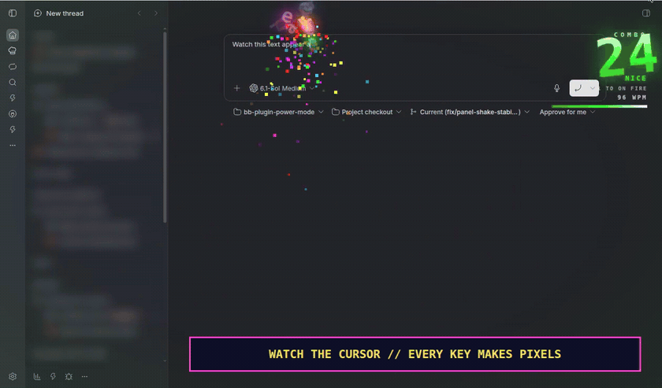

<div align="center">

# ⚡ POWER MODE ⚡

**YOUR KEYBOARD IS NOW AN ARCADE CABINET.**

`👾 RETRO 8-BIT` · `🔥 GODLIKE` · `✨ PARTICLES 1.5×` · `💡 GLOW 70%`

[](docs/media/power-mode-demo.mp4?raw=true)

**[▶ WATCH THE 47-SECOND PIXEL CHAOS](docs/media/power-mode-demo.mp4?raw=true)** · **[⚡ EQUIP POWER MODE](#-press-start)**

[Vertical video · 9:16](docs/media/power-mode-vertical.mp4?raw=true) · [Still preview](docs/media/power-mode-demo-poster.jpg) · Silent demo; flashing effects and screen shake.

</div>

I was going to write one tiny prompt. Then my keyboard started throwing pixels. The combo climbed. The screen shook. **GODLIKE.** Obviously I had to keep going.

One more sentence. One more task. One more glorious explosion. My gamer brain has apparently decided that the backlog is a boss rush, and I am extremely here for it.

Power Mode turns typing in [bb](https://getbb.app) into particles, combos, fireworks and ridiculous celebrations. The productivity buff? That's the fantasy: shiny feedback that makes you *want* to keep building. The explosions are real.

## ⌨️ Type. Combo. Lose your entire mind.

Every keystroke kicks out particles and flying letters. Backspace throws red shards. Enter lands a shockwave. Keep typing and the combo counter climbs through milestone slams, lightning and fireworks.

The WPM gauge is right there. The timer is draining. You save the combo at the last instant: **CLUTCH!** Beat your record and the HUD crowns your run. I know these are pixels. I still want the pixels.

## 💣 Pasting is an airstrike now.

Typing brings the sparks and combo explosions. **Pasting drops the actual ordnance.** A little snippet gets dynamite; a bigger chunk calls in rockets; a wall of text brings a bomber. Retro 8-bit turns the weapons into chunky pixel sprites.

There are weapons across 9 levels, from firecracker to singularity. Chain pastes within five seconds for bigger blasts, or catch a **LUCKY!** upgrade. Yes, there is a black hole. Yes, it eats the fireworks.

## 🤖 PLAYER 2 HAS ENTERED THE CHAT

**Your agent gets Power Mode too.** While its reply streams, sparks fly from the newest text and a separate word combo builds from **AGENT IS COOKING** toward **AGI ACHIEVED?!** When the turn finishes: **TURN COMPLETE**, with a bigger firework finale for longer replies.

You type. It cooks. Both sides of the conversation get the victory screen. The video shows a real agent reply, not a canned animation.

## 🏆 Loot for the part of my brain that loves shiny things

**Stats & achievements:** 57 badges across Human, Agent, and Together. Hidden discoveries. Rare, epic and legendary unlocks. Confetti. Cosmetic titles. A collection meter that is absolutely going to make me say “just one more.”

Pin a challenge beside your WPM, chase a personal best, or open the gallery and click an earned badge to replay its celebration. Revision and theme challenges count too; you do not have to be a speedrunner to collect cool stuff.

**Haptics? Oh, we brought rumble.** On phones with browser vibration support, big moments buzz: combo milestones, records, badge unlocks, huge detonations and agent finales. Higher ranks get more punch. Ordinary keystrokes stay quiet. Enable **Vibration** in Settings; this needs a supporting browser/device, such as Chromium on Android, and does not work in iOS Safari.

Optional synth blips and booms complete the loadout. The demo is silent; it cannot demonstrate physical haptics.

## ⚡ Press start

Already want the pixels? Install into your running [bb](https://getbb.app):

```sh
bb plugin install https://github.com/cleanunicorn/bb-plugin-power-mode
```

Review and accept the installation prompt, then:

1. Click **⚡ Toggle Power Mode** in the sidebar footer, or press **Ctrl+Alt+P** (**⌘+Alt+P** on Mac).
2. Open **Settings → Power Mode** and equip the demo loadout:

   | Setting | Equip |
   | --- | --- |
   | Intensity | **Godlike** |
   | Theme | **👾 Retro 8-bit** |
   | Particles | **1.5×** |
   | Glow | **70%** |
   | Agent Power Mode | **On** |

3. Type in a composer. Paste a snippet. Ask your agent something. Enjoy the completely unreasonable amount of celebration.

Retro intentionally skips bloom to keep its pixels crisp; the Glow slider remains at 70% in this loadout. Switch themes to see the bloom.

**Themes:** 🌈 Neon, 🔥 Inferno, 🟩 Matrix, 🌸 Sakura, 🌃 Cyberpunk, 👾 Retro 8-bit

Requires bb 0.48+ and plugin SDK 0.6.132+ support. BB checks compatibility during installation.

<details>
<summary><strong>📖 Inspect the arsenal: all nine paste tiers</strong></summary>

| Tier | Weapon | Paste size (chars) | Combo |
|---|---|---|---|
| 1 | Firecracker: a string of 4–6 pops | < 50 | +5 |
| 2 | Dynamite: 1–3 sticks with burning fuses | 50–200 | +10 |
| 3 | Cluster bomb: a canister splits into 6 bomblets | 200–600 | +15 |
| 4 | Rocket barrage: 3–6 rockets from the screen edges | 600–2k | +20 |
| 5 | Carpet bombing: a bomber drops 8–12 bombs along the caret's row | 2k–6k | +30 |
| 6 | Orbital strike: a reticle locks on, a beam sweeps 3 blasts | 6k–20k | +40 |
| 7 | Meteor shower: 8–10 meteors, edges dim | 20k–60k | +50 |
| 8 | Tactical nuke: siren, white-out, mushroom cloud, aftershocks | 60k–200k | +75 |
| 9 | Singularity: a black hole pulls in every particle, then goes supernova | ≥ 200k | +100 |


Paste sizes are approximate tier boundaries; the [reference](docs/power-mode-reference.md#paste-ordnance) covers lucky drops, chains and event limits. Combo records and achievements credit at most +10 per paste.

</details>

<details>
<summary><strong>⚙️ Tune the chaos, keep your progress</strong></summary>

- **Your comfort, your loadout.** Toggle individual effects, turn particles off, or use Reduce motion to suppress shake, full-screen flashes and lightning. It follows your OS until you make an explicit choice. Keep text clear softens effects near your writing.
- **Where it works.** Text editors and fields, plus streaming agent replies. Terminal input is excluded. Achievement input tracking uses supported BB composers; agent rewards require a complete observed reply in the visible thread.
- **Settings follow you.** Effect settings are saved on your bb server and synchronized across its browsers and devices.
- **Badges stay local.** Stats and achievements live in this browser's local storage. Clearing site data removes them; multiple windows can overwrite each other's progress. No leaderboards, streak penalties or remote achievement analytics. Draft and reply content is not persisted by the achievement system.

[Full behavior and storage details](docs/power-mode-reference.md) · [Achievement catalog](docs/achievements/catalog.md) · [Recording notes](docs/demo-video.md)

</details>

---

**The next task is a boss fight. [Equip your keyboard.](#-press-start)**
